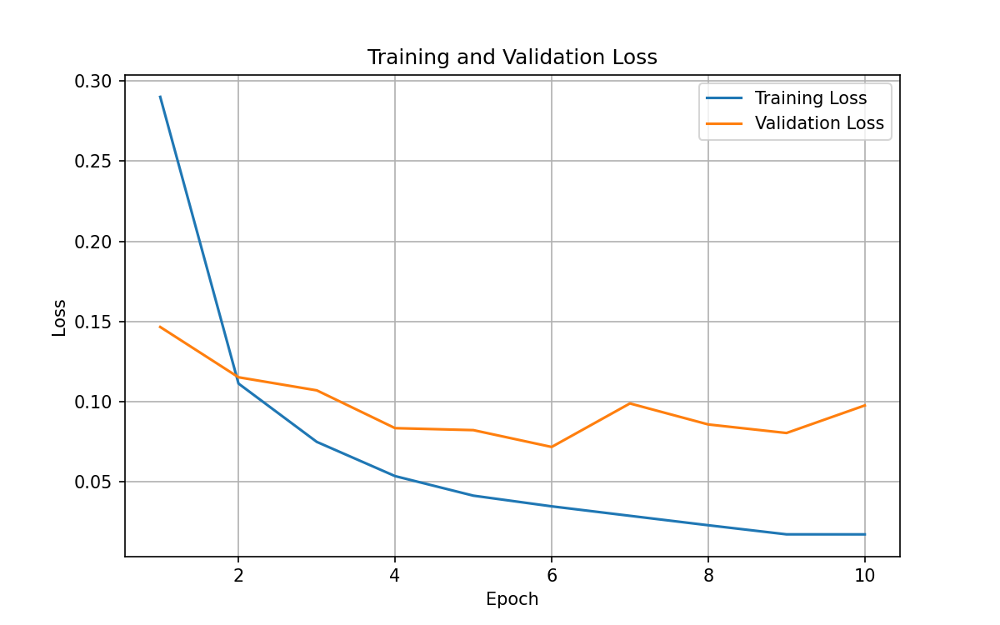
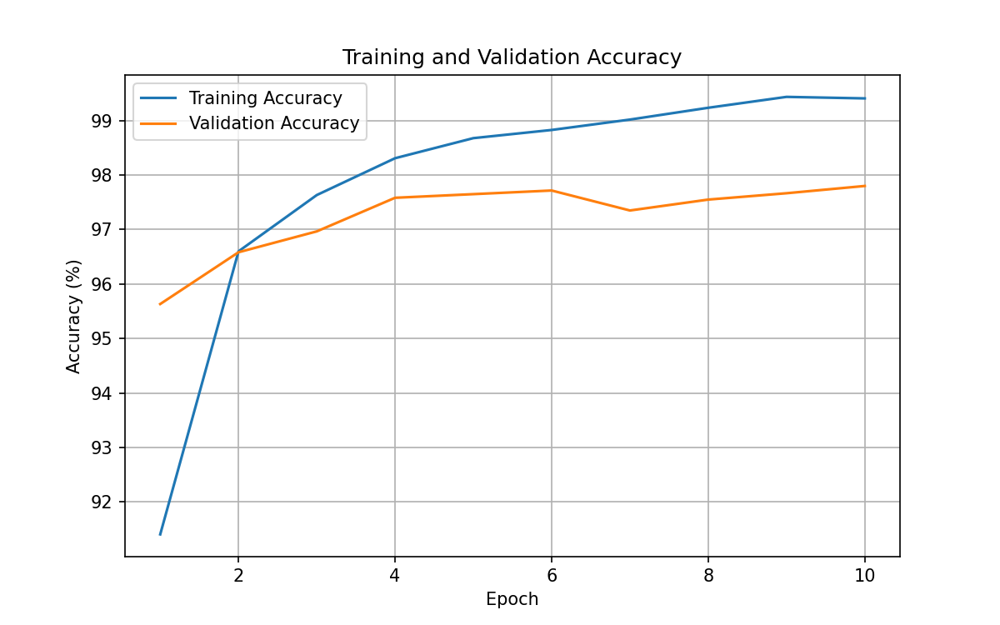
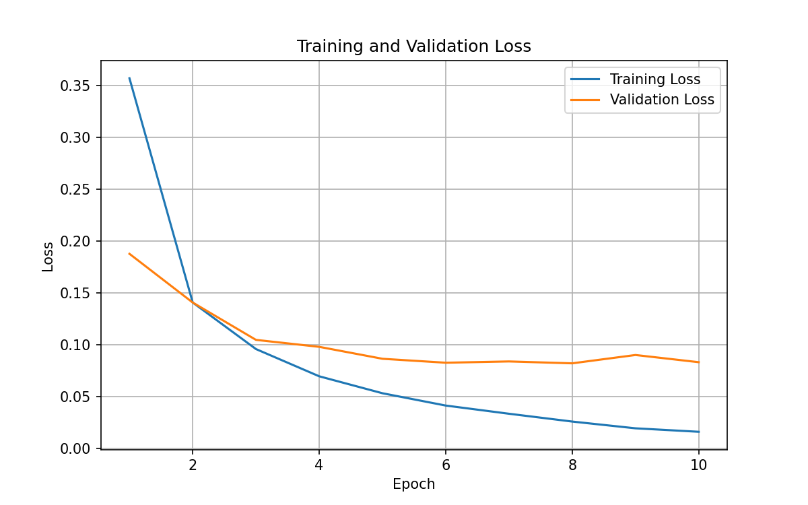
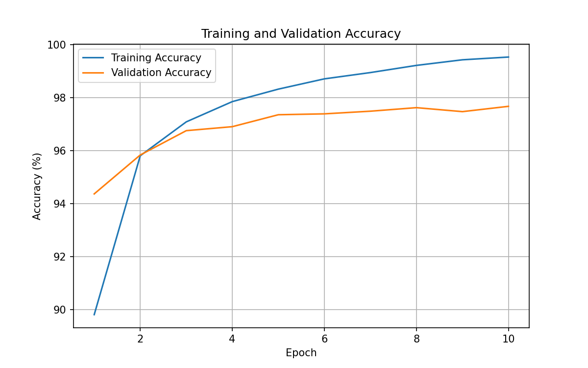
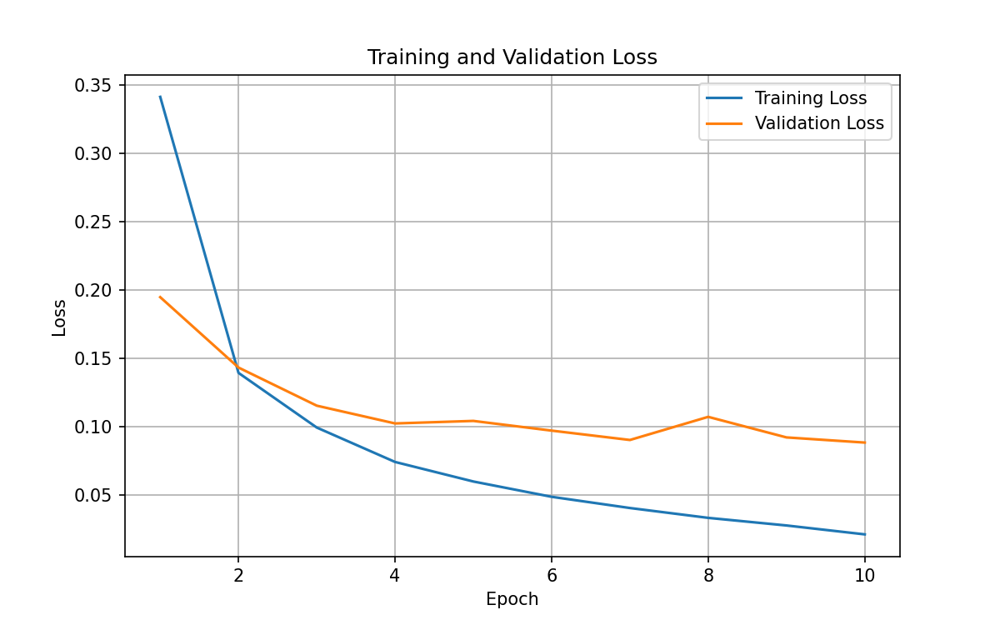
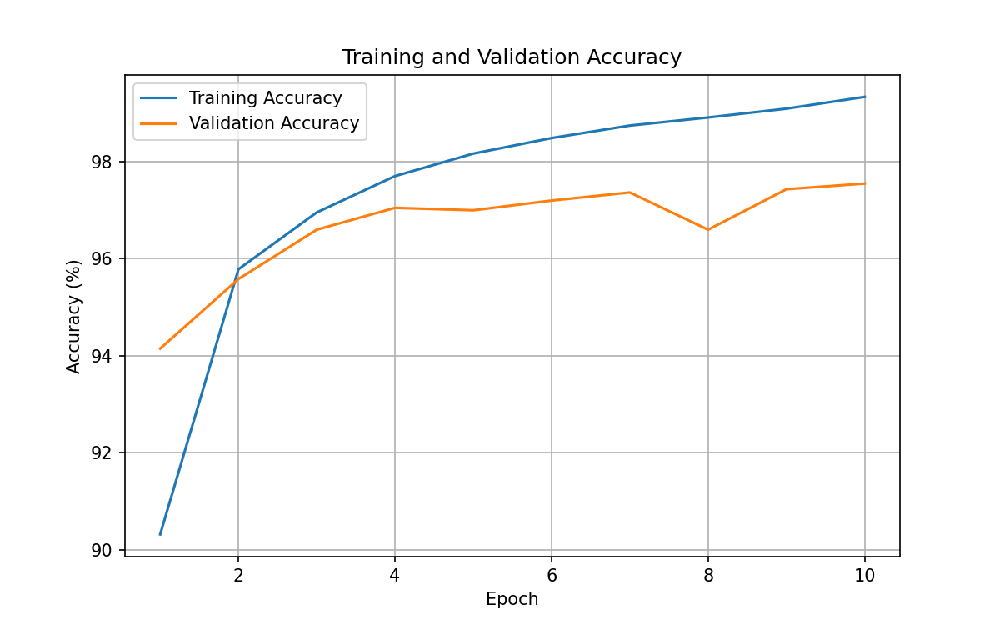
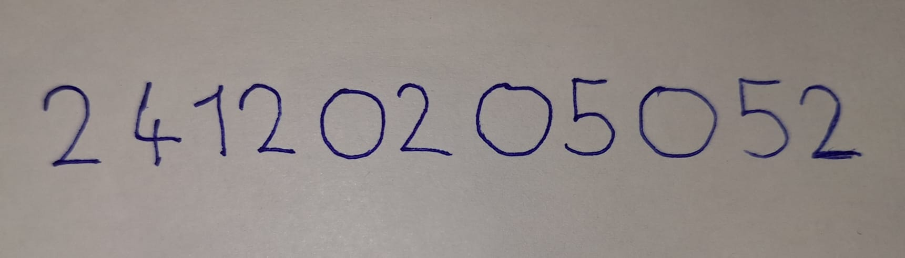

# MNIST Veri Seti ile MLP Tabanlı El Yazısı Rakam Tanıma

## 1. Projenin Amacı

Bu projede MNIST el yazısı rakam veri seti kullanılarak bir Multi-Layer Perceptron (MLP) modeli geliştirilmiştir.

Amaç, 0–9 arasındaki el yazısı rakamlarını sınıflandırabilen bir yapay sinir ağı oluşturmak, farklı hiperparametrelerin performansa etkisini incelemek ve eğitilen modeli kendi el yazımla oluşturduğum öğrenci numarası üzerinde değerlendirmektir.

Proje Python ve PyTorch kullanılarak geliştirilmiştir. CNN veya hazır eğitilmiş model kullanılmamış, MLP modeli sıfırdan eğitilmiştir.

## 2. Kullanılan Veri Seti

MNIST veri seti toplam 70.000 adet, 28×28 piksel boyutunda gri tonlamalı rakam görüntüsünden oluşmaktadır.

Veri seti şu şekilde ayrılmıştır:

| Veri Kümesi | Görüntü Sayısı |
|---|---:|
| Training | 54.000 |
| Validation | 6.000 |
| Test | 10.000 |

Görüntülere `ToTensor()` ve `Normalize((0.1307,), (0.3081,))` dönüşümleri uygulanmıştır.

Validation kümesi eğitim verilerinden ayrılmıştır. Test kümesi ise model seçimi ve geliştirme aşamasında kullanılmamıştır.

## 3. MLP Mimarisi

Temel model aşağıdaki katmanlardan oluşmaktadır:

- Giriş katmanı: 784 özellik (28×28 piksel)
- Birinci gizli katman: 256 nöron, ReLU
- İkinci gizli katman: 128 nöron, ReLU
- Çıkış katmanı: 10 sınıf

Görüntüler MLP'ye verilmeden önce tek boyutlu vektöre dönüştürülmektedir.

Eğitim için kullanılan hiperparametreler:

| Hiperparametre | Değer |
|---|---|
| Loss fonksiyonu | CrossEntropyLoss |
| Optimizer | Adam |
| Batch size | 128 |
| Epoch | 10 |
| Learning rate | Deneye göre değişken |
| Çalışma ortamı | CPU |
| Random seed | 42 |

## 4. Deneyler ve Sonuçlar

Üç farklı deney gerçekleştirilmiştir.

| Özellik | Deney 1 | Deney 2 | Deney 3 |
|---|---|---|---|
| Hidden layer 1 | 256 | 256 | 128 |
| Hidden layer 2 | 128 | 128 | 64 |
| Learning rate | 0.001 | 0.0005 | 0.001 |
| En iyi epoch | 6 | 8 | 10 |
| Training loss | 0.0349 | 0.0262 | 0.0212 |
| Validation loss | 0.0719 | 0.0823 | 0.0884 |
| Training accuracy | %98,83 | %99,21 | %99,34 |
| Validation accuracy | %97,72 | %97,62 | %97,55 |
| Eğitim süresi | 37,62 sn | 38,12 sn | 36,25 sn |

Tablodaki loss ve accuracy değerleri, her deneyde en düşük validation loss elde edilen epoch'a aittir. Epoch bazındaki tüm sonuçlar `history.csv` dosyalarında bulunmaktadır.

### Deney 1

256 ve 128 nöronlu iki gizli katmana sahip model, 0.001 learning rate ile eğitilmiştir.

En düşük validation loss değeri 6. epoch'ta 0.0719 olarak ölçülmüştür. Sonraki epoch'larda training loss azalmaya devam ederken validation loss dalgalanmıştır. Bu durum hafif overfitting belirtisi olarak değerlendirilmiştir.

### Deney 2

Model mimarisi değiştirilmeden learning rate 0.0005'e düşürülmüştür.

Daha düşük öğrenme hızının başlangıçta daha yavaş öğrenmeye neden olduğu ve gerçekleştirilen deneyde validation loss açısından ilk deneyin gerisinde kaldığı gözlemlenmiştir.

### Deney 3

Gizli katmanlardaki nöron sayıları 128 ve 64'e düşürülmüştür.

Daha küçük modelde eğitim süresi 36,25 saniye olarak ölçülmüştür. Ancak validation loss, Deney 1'e göre daha yüksek kalmıştır.

### Model Seçimi

En düşük validation loss değerini elde ettiği için Deney 1 modeli seçilmiştir. Modelin 6. epoch'taki ağırlıkları `models/experiment_1/best_mlp.pth` dosyasında saklanmıştır.

## 5. Eğitim Grafikleri

### Deney 1

### Deney 2

### Deney 3

Grafiklerde eğitim ilerledikçe training accuracy değerlerinin yükseldiği ve training loss değerlerinin düştüğü görülmektedir.

Validation loss değerleri ise bazı epoch'larda artış göstermiştir. Bu durum modelin eğitim verilerine aşırı uyum sağlama eğilimiyle ilişkilidir.

## 6. Test Sonuçları

Validation sonuçlarına göre seçilen Deney 1 modeli, eğitim ve model seçimi sırasında kullanılmayan 10.000 MNIST test görüntüsüyle değerlendirilmiştir.

| Metrik | Sonuç |
|---|---:|
| Toplam test görüntüsü | 10.000 |
| Doğru tahmin | 9.792 |
| Yanlış tahmin | 208 |
| Test loss | 0.0660 |
| Test accuracy | %97,92 |

Bu sonuç, seçilen MLP modelinin MNIST test kümesinde yüksek sınıflandırma başarısı elde ettiğini göstermektedir.

## 7. Kendi El Yazımla Test

Kendi el yazımla oluşturduğum öğrenci numarasının fotoğrafı çekilmiş ve görüntü işleme adımlarıyla modele uygun hâle getirilmiştir.

Uygulanan işlemler:

1. Görüntünün gri tonlamaya dönüştürülmesi
2. Eşikleme ile yazı piksellerinin belirlenmesi
3. Rakamların birbirinden ayrılması
4. Görüntülerin 28×28 piksele dönüştürülmesi
5. Rakamların siyah arka plan üzerinde açık renkli hâle getirilmesi ve ortalanması
6. Eğitimde kullanılan normalizasyonun uygulanması
7. Eğitilmiş MLP modelinden tahmin alınması

### Orijinal Görüntü

### İşlenmiş Rakamlar

### Sonuçlar

| Metrik | Sonuç |
|---|---:|
| Toplam rakam | 11 |
| Doğru tahmin | 9 |
| Yanlış tahmin | 2 |
| El yazısı doğruluğu | %81,82 |

Yanlış sınıflandırmalar:

- Gerçek rakam 1 iken model 9 tahmin etmiştir.
- Gerçek rakam 0 iken model 5 tahmin etmiştir.

## 8. Distribution Shift ve Generalization Değerlendirmesi

MNIST test kümesinde %97,92 doğruluk elde edilirken kendi el yazımla oluşturduğum 11 rakamlık örnekte %81,82 doğruluk elde edilmiştir.

Bunun olası nedenleri arasında el yazısı biçimlerinin farklılığı, kullanılan kalem, fotoğrafın ışık koşulları ve görüntü işleme aşamasında oluşan değişiklikler bulunmaktadır.

Bu gözlem, eğitim verisiyle gerçek hayat verileri arasındaki dağılım farklılığının model tahminlerini etkileyebileceğini göstermektedir.

Bununla birlikte, kendi el yazısı deneyinin yalnızca 11 rakam içermesi nedeniyle elde edilen doğruluk oranı, modelin genel gerçek dünya performansını temsil eden güvenilir bir tahmin olarak değerlendirilmemelidir.

## 9. Kurulum ve Çalıştırma

Proje klasöründe bir Python sanal ortamı oluşturulup etkinleştirilmelidir.

Gerekli kütüphaneler `requirements.txt` dosyasından kurulabilir.

Çalıştırma dosyaları:

- `explore_data.py`: MNIST veri setini yükleme ve inceleme
- `model.py`: MLP mimarisini tanımlama
- `train.py`: Modeli sıfırdan eğitme ve grafik oluşturma
- `evaluate_test.py`: Seçilen modeli MNIST test kümesinde değerlendirme
- `predict.py`: Kendi el yazısı görüntüsünden rakam tahmini gerçekleştirme

Deneyler `train.py` içerisindeki learning rate ve gizli katman nöron sayıları değiştirilerek tekrarlanabilir.

## 10. Genel Değerlendirme

Bu projede MLP mimarisinin MNIST veri seti üzerinde el yazısı rakam sınıflandırması için etkili olduğu gözlemlenmiştir.

Üç farklı deney sonucunda, kullanılan yapılandırmalar arasında en düşük validation loss değerini 256–128 nöronlu ve 0.001 learning rate kullanılan model elde etmiştir.

Model, MNIST test kümesinde %97,92 doğruluk sağlamıştır. Kendi el yazısı örneğinde ise 11 rakamın 9'unu doğru sınıflandırmıştır.

Bu çalışma sayesinde MLP mimarisi, hiperparametrelerin etkisi, eğitim ve doğrulama metrikleri, overfitting, model seçimi ve distribution shift kavramları uygulamalı olarak incelenmiştir.